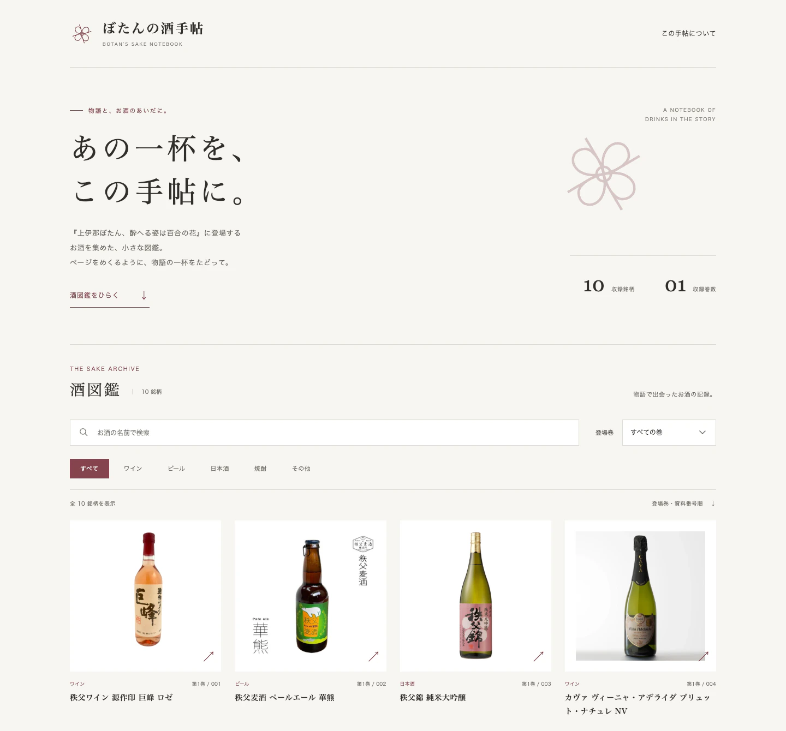
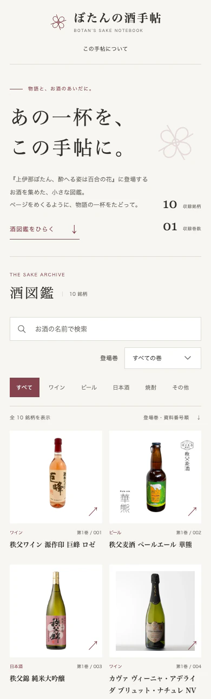
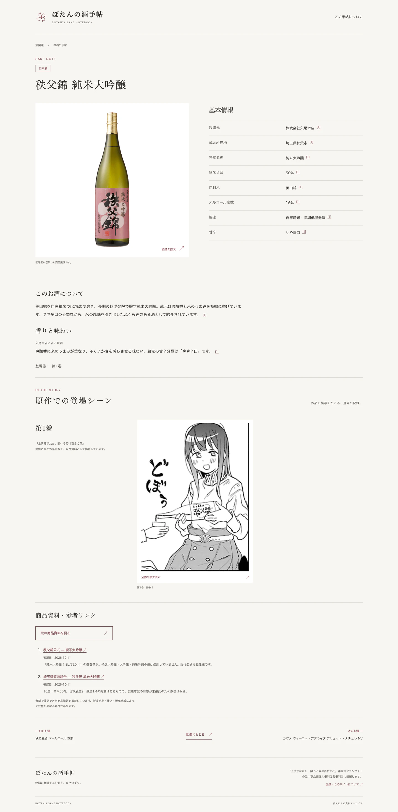

<div align="center">

<h1>ぼたんの酒手帖</h1>
<p>《上伊那ぼたん、酔へる姿は百合の花》非官方酒款图鉴</p>
<p>作品からたどる、小さなお酒の図鑑。</p>

<p>
  
  
  
  <a href="https://github.com/icytail176/botan-sake/actions/workflows/deploy.yml"></a>
</p>

<p><a href="https://icytail176.github.io/botan-sake/"><strong>在线访问 / Webサイト →</strong></a></p>

</div>

[简体中文](#简体中文) · [日本語](#日本語)

---

## 简体中文

### 项目简介

**ぼたんの酒手帖** 将《上伊那ぼたん、酔へる姿は百合の花》中登场的酒款整理成一本可以浏览的小图鉴。
从商品实物图、作品截图到可追溯的商品资料，让读者沿着作品认识每一款酒。

网站已公开发布，现收录10款酒。页面保持简洁的日文排版，适配桌面和手机。
**网站界面为日文；本 README 提供中文和日文说明。**

### 网站预览

以下均为[正式网站](https://icytail176.github.io/botan-sake/)的真实截图，图片保存在本仓库。
点击图片可查看原图。



<details>
<summary>查看手机端首页与酒款详情 / モバイル・銘柄詳細</summary>

**手机端首页 / モバイルのトップページ**

<a href="docs/assets/home-mobile.webp"></a>

**秩父錦 純米大吟醸详情 / 銘柄の詳細ページ**



</details>

### 主要功能

- **浏览与查找**：商品图片图鉴、日文酒名搜索、酒类和漫画登场卷筛选。
- **了解酒款**：详细规格、商品介绍、风味与品牌背景，附具体来源和考据记录。
- **回到作品**：原比例漫画截图、Lightbox放大查看、前后酒款导航。
- **随处阅读**：响应式布局，本地图片资源，静态页面可直接访问。

### 技术栈

Astro · TypeScript · 原生 CSS · Sharp。静态生成，由 GitHub Actions 构建并发布到 GitHub Pages。

### 本地运行

Node.js 22.12+，推荐24 LTS。在项目根目录执行：

```sh
npm ci
npm run dev
```

访问终端显示的 `http://127.0.0.1:4321/botan-sake/`。完整验证：

```sh
npm run verify
```

### 项目维护文档

| 文档 | 内容 |
| --- | --- |
| [内容维护指南](docs/CONTENT_GUIDE.md) | 图片命名、info.txt、人工数据、新卷与跨卷关联 |
| [商品资料考据](docs/RESEARCH_GUIDE.md) | 规格、介绍、风味、来源及版本冲突 |
| [构建与部署](docs/DEPLOYMENT.md) | 本地检查、Git提交、Actions与线上验收 |
| [update-sake-catalog Skill](.agents/skills/update-sake-catalog/SKILL.md) | 辅助新增酒款、维护资料和执行验证 |
| [AGENTS.md](AGENTS.md) | Codex项目协作规则 |

维护资料时可使用 `$update-sake-catalog`。人工资料写入 `data/manual.json`，重新导入不会覆盖；详细操作请按上表查阅。

### 非官方声明与版权

本项目为非官方粉丝资料整理网站，与作品出版社、动画制作方及酒类生产商无官方关联。
漫画和动画截图、商品照片及商标等权利属于各自权利人。商品规格及背景资料尽量标注具体可靠来源；风味描述注明其来源归属。

仓库公开不代表源码和图片均获自由再许可授权；目前未设置统一的 LICENSE。
纠错、资料补充及权利相关反馈请使用 [GitHub Issues](https://github.com/icytail176/botan-sake/issues)。

---

## 日本語

### プロジェクトについて

**ぼたんの酒手帖** は、『上伊那ぼたん、酔へる姿は百合の花』に登場するお酒をまとめた非公式の小さな図鑑です。
商品の写真、原作の登場シーン、出典をたどれる商品情報を通して、作品で出会った一杯を調べられます。

現在は10銘柄を公開しています。落ち着いた日本語の組版で、PCでもスマートフォンでも読みやすい構成を目指しています。
**WebサイトのUIは日本語です。このREADMEは中国語・日本語で案内しています。**

### スクリーンショット

[上のプレビュー](#网站预览)に、公開中のサイトを実際に撮影した画面を掲載しています。

- [PCのトップページ](docs/assets/home-desktop.webp)
- [スマートフォンのトップページ](docs/assets/home-mobile.webp)
- [秩父錦 純米大吟醸の詳細ページ](docs/assets/sake-detail.webp)

画像はリポジトリ内で管理しています。[Webサイトを開く →](https://icytail176.github.io/botan-sake/)

### 主な機能

- **銘柄を探す**：商品写真の一覧、日本語の銘柄名検索、酒類・登場巻による絞り込み。
- **お酒を知る**：商品仕様、紹介文、香りや味わい、造り手の背景と参照資料。
- **原作を読み返す**：元の縦横比を保った登場シーン、Lightboxでの拡大表示、前後の銘柄への移動。
- **端末を選ばず読む**：レスポンシブな静的ページと、リポジトリ内で管理する画像。

### 技術スタック

Astro · TypeScript · CSS · Sharp。静的サイトをGitHub Actionsでビルドし、GitHub Pagesで公開しています。

### ローカルでの実行

Node.js 22.12以上を使用してください。24 LTSを推奨します。プロジェクトのルートで実行します。

```sh
npm ci
npm run dev
```

ターミナルに表示される `http://127.0.0.1:4321/botan-sake/` を開きます。データとビルドの検証：

```sh
npm run verify
```

### ドキュメント

以下の詳しいメンテナンス資料は中国語で記載しています。

| ドキュメント | 内容 |
| --- | --- |
| [コンテンツの管理](docs/CONTENT_GUIDE.md) | 画像名、info.txt、手動データ、新しい巻・巻をまたぐ関連付け |
| [商品情報の調査](docs/RESEARCH_GUIDE.md) | 仕様・紹介文・味わいの記録、出典と版の違い |
| [ビルドと公開](docs/DEPLOYMENT.md) | ローカル検証、Git、Actions、公開後の確認 |
| [update-sake-catalog Skill](.agents/skills/update-sake-catalog/SKILL.md) | 銘柄の追加、情報の更新、検証を補助するCodex Skill |
| [AGENTS.md](AGENTS.md) | Codex向けのプロジェクトルール |

Codexでの更新には `$update-sake-catalog` を利用できます。手動の情報は `data/manual.json` に保存し、再インポート時にも維持されます。

### 免責事項・著作権について

本サイトはファンによる非公式の資料整理プロジェクトです。原作の出版社、アニメ制作関係者、酒類メーカーとの公式な関係はありません。
漫画・アニメの画像、商品写真、商標などの権利は、それぞれの権利者に帰属します。商品仕様や背景情報にはできる限り具体的な出典を示し、味わいの説明にも情報提供元を記載しています。

リポジトリの公開は、コードや画像の自由な再利用を一律に許諾するものではありません。現時点で全体を対象とするLICENSEは設けていません。
誤記、追加情報、権利に関するお問い合わせは [GitHub Issues](https://github.com/icytail176/botan-sake/issues) へお願いします。
